# Probably a Tragedy

> **Watch it first:** a narrated 4-minute walkthrough (real animation, live LangGraph graphs, a LangSmith trace) is attached to the
> [v0.1.0 release](https://github.com/garyamorris/probably-a-tragedy/releases/tag/v0.1.0). Run it yourself with `make install && make dev`,
> then open http://127.0.0.1:2027/app/. Licensed MIT.

**A puppet-theatre game built as nine LangGraph workflows.** You are the Prompter, hidden in the box at the foot of a toy
theatre. The Wibbling Players, a troupe of puppets that cannot be trusted, improvise a new play in a new town every night.
Cast them, pick the script, then whisper the right line (or the wrong one) when a flaw meets a plot beat and the stage
freezes. A tour is five nights; the goal is 15 stars from five pigeon critics.

It is the playful sibling of the serious Foghorn incident-command app: same idea (one deployment, many LangGraph graphs,
datasets, agents, Studio-ready), but a game you want to play. It runs **fully offline** (a deterministic fake LLM gives the
puppets their voices); a real model (OpenAI or Claude) is opt-in. Studio and LangSmith tracing appear only as a small "Prompt Book" in the corner.

```bash
uv sync
make dev                      # langgraph dev on :2027 (provider + tracing come from .env)
open http://127.0.0.1:2027/app/
```

**Configuration is the git-ignored `.env`** (`langgraph.json` points `langgraph dev` at it; `.env.example` lists every option). On this machine it
holds the OpenAI and LangSmith keys (copied from the shell environment), `TRAGEDY_PROVIDER=openai` and `LANGSMITH_TRACING=true`, so a plain
`make dev` voices the puppets with OpenAI and sends runs to the `probably-a-tragedy` LangSmith project, which is what makes **LangGraph Studio's
connection work** (without a key and tracing on, Studio shows an orange "LANGSMITH_API_KEY is missing" banner) and what the in-game "View trace" link
needs. For the free, deterministic, no-network version set `TRAGEDY_PROVIDER=offline` in `.env`. `make dev TRACE=1` forces tracing on and
`make dev NOTRACE=1` off. The test suites pin themselves offline and untraced (`tests/conftest.py`), so the `.env` never leaks into them.

**Running graphs straight from LangGraph Studio.** Studio's form sends a field or two, not the whole payload the game builds. `performance`,
`almanac` and `the_road` start with a `defaults` step (`src/tragedy/flows/defaults.py`) that fills in only what was left blank (a tour,
a seed, a recommended cast, a drafted script, a headless result for the almanac) and says so in a note. It never overrides what you typed and does nothing when the game sends
everything. Try `{"genre": "farce"}` on `performance`, or `{}` on `the_road`. **The OpenAI key box in Studio's "LangSmith Chat" panel is LangSmith's hosted
UI and keeps its key in your browser, so no server can fill it in.** `make copy-key` puts the key from `.env` on your clipboard without printing it
(`make copy-key K=LANGSMITH_API_KEY` for another), and you paste it there.

Real models only ever give the puppets a *voice*; scores never depend on model text.

```bash
TRAGEDY_PROVIDER=openai OPENAI_API_KEY=... make dev       # verified live (gpt-5.4-mini); models: TRAGEDY_OPENAI_MODEL_FAST / _SMART
TRAGEDY_PROVIDER=anthropic ANTHROPIC_API_KEY=... make dev # verified live (claude-haiku-5-5); an unscoped key also needs ANTHROPIC_WORKSPACE_ID
```
`auto` picks Anthropic, then OpenAI, if a key is present; the default is `offline` even when keys exist. `GET /api/boot` reports the
live provider, model and how many `voice()` calls actually changed text or fell back.

## A look at it

Real screenshots from a play-through (offline model, real server). The first four are the pre-show; then the show itself.

| | |
|---|---|
| 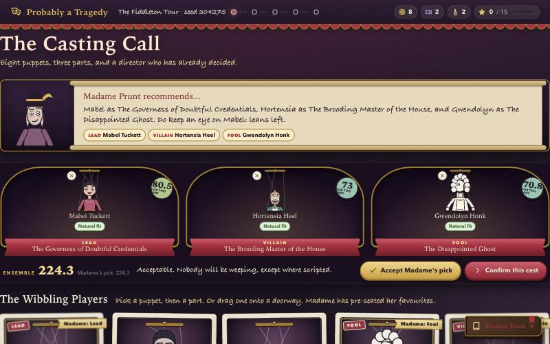 **Casting call**: Madame recommends, you cast | 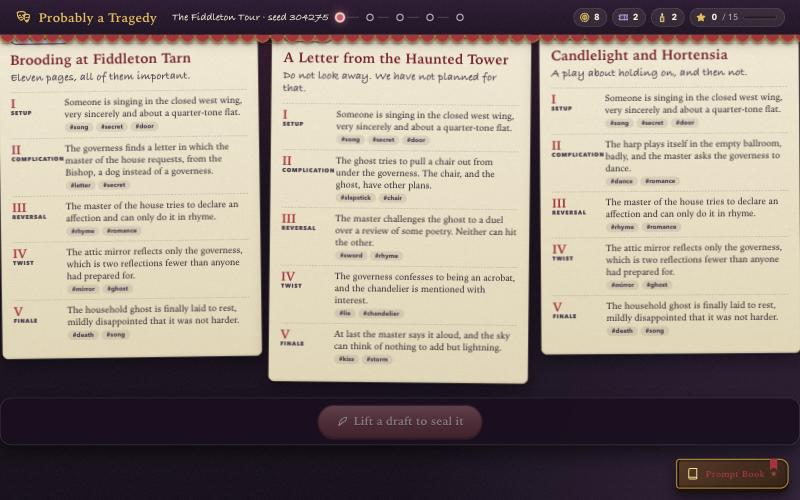 **Writers' room**: three quills, three drafts |
| 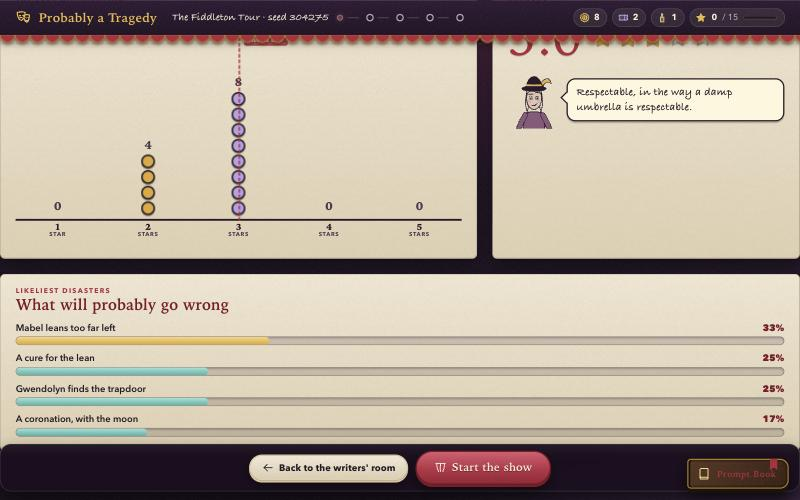 **Dress rehearsal**: twelve imaginary nights | 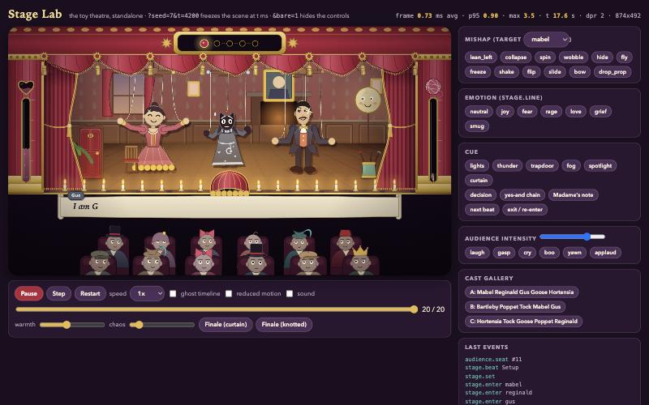 **The theatre** (canvas, ~1 ms a frame) |
| 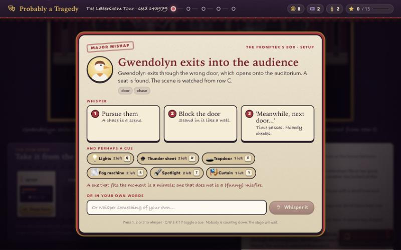 **The Prompter's Box**: whisper, cue, or your own words | 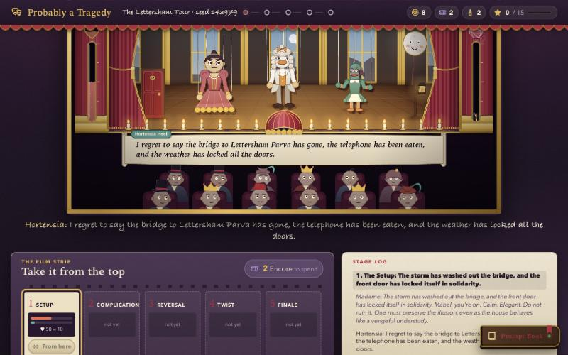 **A live show** with the film strip and stage log |
| 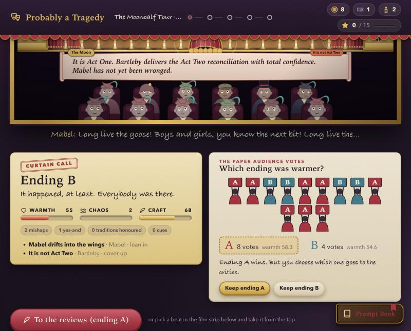 **Take it from the top**: fork, then the paper audience votes | 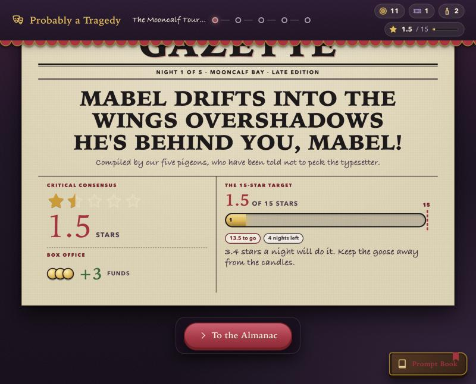 **The pigeon critics' front page** |
| 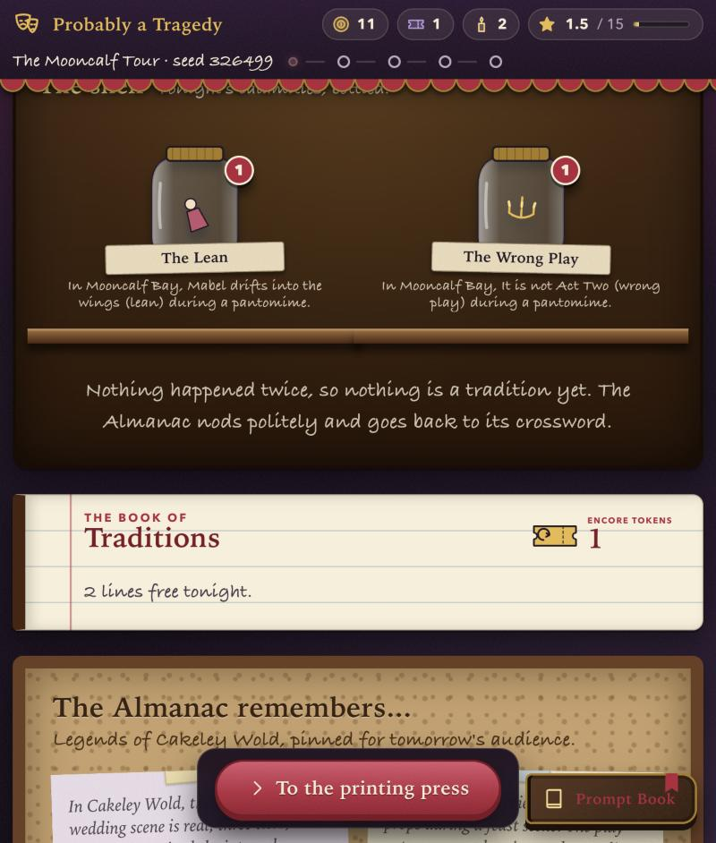 **The Almanac of Calamities** | 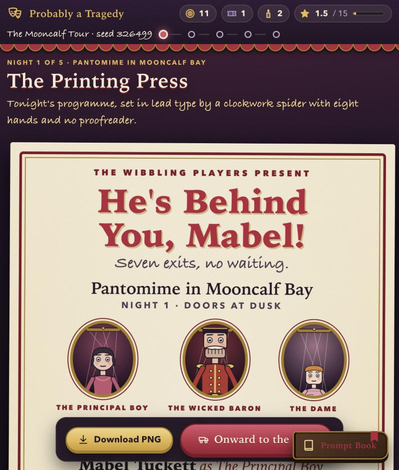 **The playbill** |
| 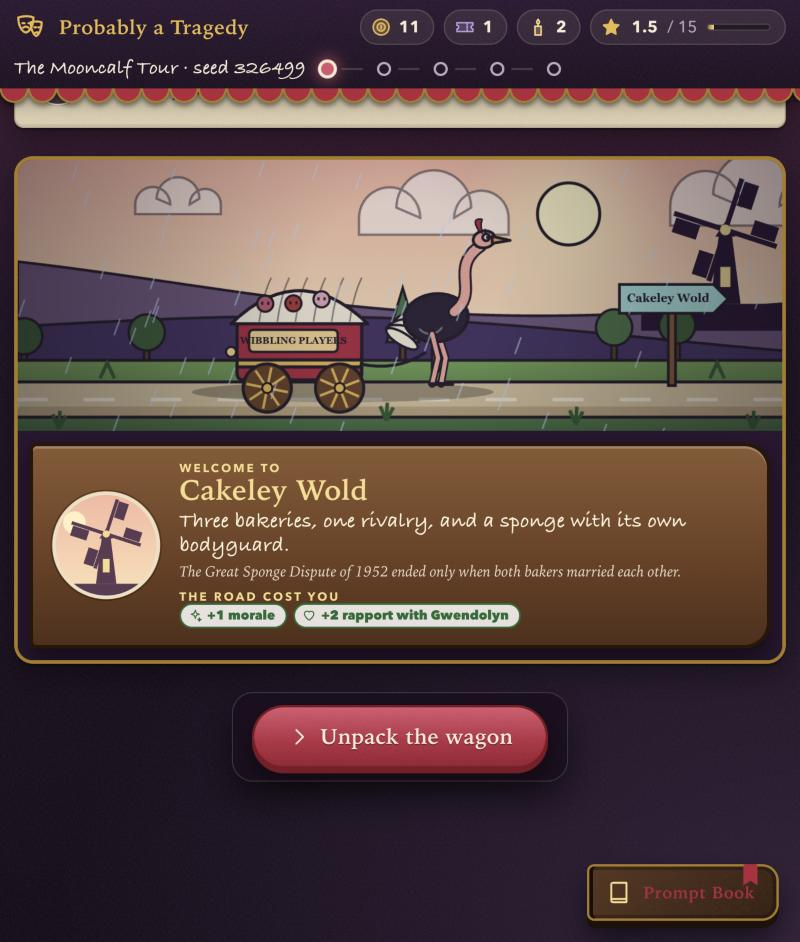 **The road** (with a real crash-and-resume) | 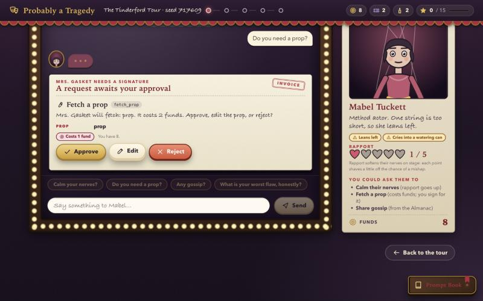 **The greenroom**: Mrs. Gasket needs a signature |
| 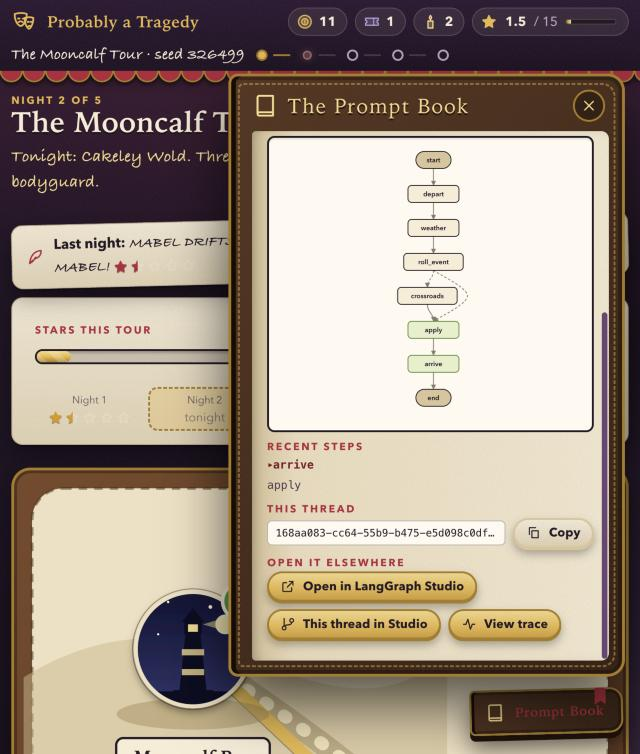 **The Prompt Book**: live graph, Studio and trace links | 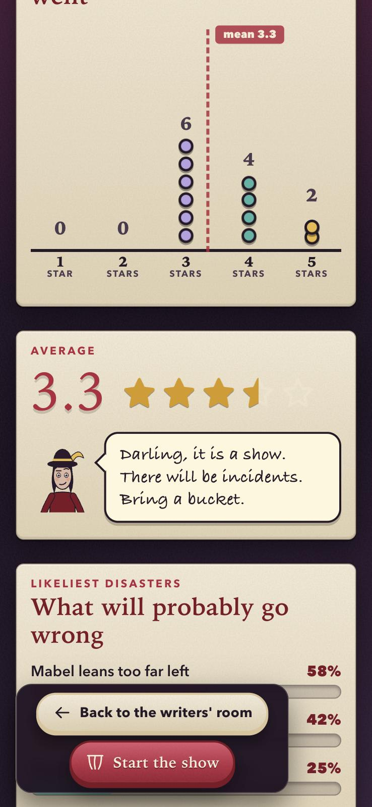 **On a phone** |

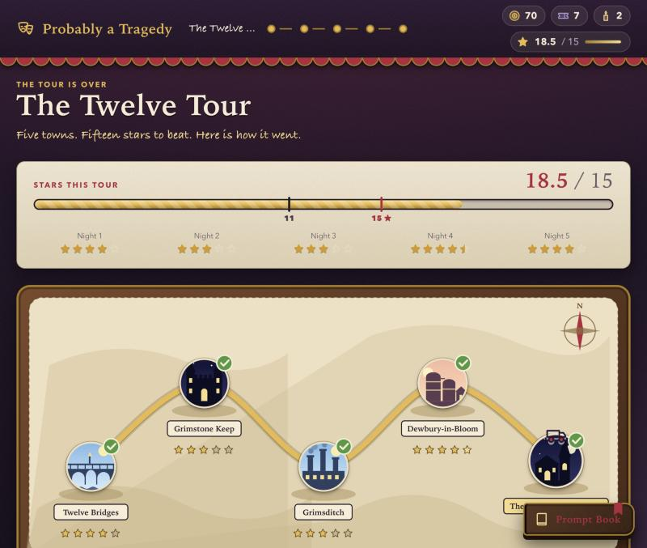 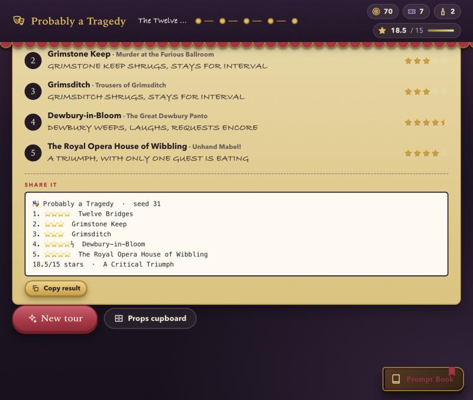
**The end of a tour**: the verdict against the 15-star target, a retrospective with the pigeons' headlines, and a shareable result.

## The nine graphs (`langgraph.json`)

| graph | in the game | LangGraph features |
|---|---|---|
| `casting_call` | auditions, Madame recommends, you confirm | `Send` x24, reducers, `defer`, `interrupt` |
| `writers_room` | three quills draft the play, you pick | `Send` x3 into a compiled **subgraph**, evaluator loop, `interrupt` |
| `rehearsal` | twelve imaginary nights, star histogram | `Send` x12, `defer`, eval vs the gold set |
| `performance` | **the show** | `Command(goto)` + `destinations`, dynamic `interrupt`, `Send` x12 audience, `RetryPolicy` + `error_handler` (the understudy goes on), checkpoint per beat = **time travel** |
| `reviews` | five pigeon critics | `Send` x5, custom reducer, token streaming, Store write |
| `almanac` | the Almanac of Calamities | Store + semantic search, memory-write `interrupt` |
| `playbill_press` | the programme | Functional API (`@entrypoint`/`@task`, `previous`) |
| `the_road` | the wagon to the next town | durable execution, real crash + resume, `interrupt` |
| `greenroom_chat` | chat with a puppet backstage | `create_agent` + middleware, tool-call review, `messages` streaming |

Fifteen deterministic datasets live in `datasets/` (performers, flaws, 100 mishaps, five genres of scripted beats, 30 towns,
audiences, critics, playbill grammar, road events, 60 legends, props, a 40-night gold set...). Everything random is a hash of
`(seed, night, beat, actor)`, so a forked or rewound timeline replays exactly.

Read next: [docs/DESIGN.md](docs/DESIGN.md) (game, mechanics, balance), [docs/DATA.md](docs/DATA.md), [docs/PROTOCOL.md](docs/PROTOCOL.md)
(graph I/O, interrupts, stream events, REST).

## Layout

```
src/tragedy/engine/   pure, deterministic show engine (graphs orchestrate; the engine decides; models only add voice)
src/tragedy/flows/    one package per graph;  src/tragedy/graphs/  the exports langgraph.json points at
src/tragedy/data/     dataset content, builder and checker;   datasets/  generated files + MANIFEST.json
src/tragedy/server/   custom FastAPI app (tour/economy, datasets, Studio + trace links) and the vanilla-JS SPA (static/)
tests/                unit, graphs, evals (gold set), e2e (a whole night over HTTP against a real langgraph dev), ui (node)
```

## Checks

```bash
make test-fast      # python: engine, data, all nine graphs, gold set      (see make test-fast)
make e2e            # a full night over real HTTP + a time-travel fork      (26 passing at last run, incl. every graph fed Studio-style sparse input)
uv run pytest -m live tests/e2e/test_live_openai.py -s   # LIVE: the whole game on a real OpenAI model (costs cents; 5 passing)
make data-check     # datasets valid and equal to generator output
node --test tests/ui/*.test.mjs   # the pure JS: stream queue, stage reducer, view helpers
uv run python -m tragedy.engine.balance   # star distributions per play style
```

## Status and known gaps (honest)

**Verified**
- The whole backend: all nine graphs, engine, 15 datasets, API, Store economy, time travel (fork from a checkpoint), real crash + resume.
- **A full night and a greenroom chat on a real OpenAI model** (`gpt-5.4-mini`): 10 voice calls, 0 fallbacks, 9 drafts reworded, and the
  show result and stars identical to the offline run (`tests/e2e/test_live_openai.py`).
- **Tracing, end to end** (`tests/e2e/test_live_tracing.py`): with `TRACE=1` the app's own `/api/links` returns a real LangSmith URL for a
  show's thread; the root run is named `performance` and carries `thread_id`, `graph_id`, `tour_id`, `run_id` metadata. The check
  writes to a throwaway project (`probably-a-tragedy-verify`, override with `TRAGEDY_TRACE_VERIFY_PROJECT`) with inputs/outputs hidden.
  Tracing follows `.env` (`LANGSMITH_TRACING`): on in a configured checkout, off in the committed `.env.example`; `NOTRACE=1` forces it off. (`langgraph dev` itself posts anonymous usage metadata, with
  zero runs, to api.smith.langchain.com at startup.) `list_runs()` is deprecated by LangSmith and removed after 2027-01-31:
  `server/links.py` should move to `client.runs.query()` before then.
- **A whole night played in a real browser against the real server** (traced, offline provider): title, tour map, genre picker, casting,
  writers' room (real pointer clicks), a full show on the canvas stage with the Prompter's Box, **Take it from the top** (the Encore token
  is spent in the Store, the show replays from the chosen beat, and the paper audience votes between the two endings), the newspaper
  reviews, the Almanac (with the next town's legends recalled by semantic search), the playbill, and the road with a **real crash and
  resume** (effects applied exactly once). No console errors, no server errors.
- **The Prompt Book with tracing on** shows the live graph, recent steps, the thread id and three working links: Open in LangGraph
  Studio, This thread in Studio, and View trace (a real LangSmith run URL).
- The theatre renders at about 1 ms a frame; a stage freeze (a NaN whisper orb) was found by playing it for real, fixed, and regression-tested.

- **The greenroom screen in a real browser**: chat with a puppet, the `calm_nerves` tool (rapport hearts fill and persist), the Invoice
  approval card for `fetch_prop` (approve spends funds, reject spends none). Playing it found two bugs that no test had caught:
  `runFlow` silently dropped the run `context` (so the tool ran against a non-existent tour and showed FAILED), and the price badge
  showed a client-side guess instead of the server's price. Both are fixed and regression-tested (`tests/ui/run-context.test.mjs`,
  `propCost` in `views-pure`).
- **Phone layouts** (375px) for rehearsal, almanac and greenroom: no horizontal overflow, sticky actions don't hide content.
  **Reduced motion**: with `?rm=1` the stage's screen shake stays at exactly 0 through a thunder cue, and every effect runs without errors.
  **Sound**: toggled by a real click, every sound-effect kind runs without errors (I could not *hear* it from here).
- The desktop left-gutter defect no longer reproduces (content starts 74px in at 1280px wide).

- **Studio's thread picker is global** (found while a user clicked around in the real Studio at `studio/?baseUrl=...`): it lists every graph's
  threads together and does *not* switch graph when you pick one, so an almanac thread opened beside the `performance` diagram looks
  "detached" (no highlighted nodes, wrong input form). That is Studio, not the server (every request was a 200 and each thread carries
  the right `graph_id`/`assistant_id`). `http://127.0.0.1:2027/go` lists each graph's newest threads with links that carry both ids, and
  `/go/thread/<id>` redirects to Studio with the right graph selected (`tests/e2e/test_studio_inputs.py`, `tests/unit/test_links.py`).

- **Studio links, verified against the real LangSmith Studio** (signed in, connected to the local server): "Open in LangGraph Studio" selects
  the graph and "This thread in Studio" opens that exact thread (the greenroom agent's real steps; a casting thread with its pending
  interrupt). My first guess at the thread link (`studio/thread/<id>`, `&graph=`) was **wrong**; the real form is Studio's own:
  `studio/thread?baseUrl=<server>&render=interact&mode=graph&assistantId=<assistant uuid>&threadId=<thread id>`. The server looks up each
  graph's assistant id (`/api/boot` exposes them) and the tests pin the shape (`tests/unit/test_links.py`, `tests/ui/api.test.mjs`,
  the end-to-end suite compares against the server's real `/assistants/search`).

- **Claude (Anthropic), live** (`tests/e2e/test_live_anthropic.py`, 5 passing): 10 voice calls, 0 fallbacks, scores identical to the offline run,
  and the greenroom agent made its own `calm_nerves` tool call. The first live attempt failed with HTTP 400 because the key is not scoped to
  a workspace: `anthropic-workspace-id` is now sent from `ANTHROPIC_WORKSPACE_ID` (unit-tested), and `voice()` counts and logs such
  fallbacks instead of failing silently, which is what exposed it.
- **Sound, measured and rebalanced**: with sound on, the Web Audio context runs (44.1 kHz) and every effect produces a non-silent signal
  (except Madame's note, exit/re-enter and the yes-and chain, silent by design; between effects the output is exactly 0). The first
  measurement found it too quiet and uneven (-36 to -17 dBFS, a 19 dB spread), so the master level was raised, a limiter added so
  overlapping effects cannot clip, and the quietest effects trimmed: now -17.6 to -3.9 dBFS, most near -12, no clipping, 13.8 dB spread.
- **Studio links, all nine graphs** in the real Studio: for a real thread on every graph, "This thread in Studio" opens the right graph and
  shows exactly that thread id in Studio's header, with the graph's own node names present (`writers_room`'s `quill` subgraph appears
  collapsed, as Studio shows subgraphs).

- **Studio's own forms, all nine graphs, over real HTTP** (`tests/e2e/test_studio_inputs.py`, 14 cases; also run once against the OpenAI-backed `.env` server,
  0 failures): `{}`, `{"genre": "farce"}`, `{"tour_id": "studio-demo"}`, a bare chat message. Before the `defaults` step, `performance`, `almanac` and `the_road`
  died with `KeyError: 'tour_id'` on exactly these inputs, which is what "it's configured but just doesn't work" was.

- **A real playthrough** (new tour, Gothic Romance in Sheetley Moor; casting, writers' room, the show with two Prompter decisions and a cue
  that landed as a miracle, reviews, almanac, playbill, the road, the greenroom agent calling its tool, the Prompt Book's Studio and trace links; run on
  OpenAI). It found eight things the test suites had not, all fixed and pinned: the title screen said "offline and deterministic" while OpenAI
  was speaking; **every spoken line dragged the page down to the stage log, away from the stage**; at ~940px the play title was squeezed to one word per
  line and pushed the theatre below the fold; the casting total showed `218.10000000000002`; **11 of 20 road events had an option strictly worse
  than another** (the checker now rejects that); the Almanac headed its legends "of Mutterby" when two were from elsewhere; the arrival card said "the
  road cost you" above two gains; and browsers kept running stale modules after an update (`Cache-Control: no-cache` now).
  **Then a full five-night tour through the real UI** (a small in-page bot that clicks the actual buttons, in the embedded browser, on OpenAI): it reached
  the ending, "A Respectable Run", 13.5 of 15 stars (2.5, 2, 4, 3, 2), with per-night headlines, the star track with its 11 and 15★ markers, and a
  shareable result. The bot played like a careless player (Madame's cast, a rotating draft, "Yes, and..." (two whispers all tour), one cue, random road choices, never visited the
  Greenroom, declined the one Tradition it was offered) and still came within 1.5 stars of a triumph, with a spread of 2 to 4 stars a night, so there is room to play better. It also
  ended with 28 funds unspent, which is what a player who ignores the Greenroom would see.
  Honest limits: the bot is not a person. I can say the game is coherent, funny on the page, tense at the end (11.5 of 15 going into the finale) and has no
  obviously wrong choice; I cannot say it is *fun*. That needs someone to play it for real.

**Not verified**: how the sound *sounds*: levels are measured but taste is a human call (no ears here).

**Known gaps**: Balance is calibrated by simulation only. After an independent fun audit (docs/DESIGN.md section 8) a careless tour averages about 12 stars, a tour that
reads the town about 15 (64% triumph), and the old zero-skill recipe (always gothic romance) no longer wins. Still open, said plainly: whispers are a real but modest lever
(~0.2 stars a night), Traditions are a nearly free +2, road choices barely move a tour, there is no progression between tours, and none of this says the game is *fun*.

## Deploy (Google Cloud Run)

The game deploys to Cloud Run as one service (`probably-a-tragedy`) with `make deploy` (needs `gcloud`, a project with billing, and the Cloud Run, Cloud Build,
Artifact Registry and Secret Manager APIs enabled).

* The `Dockerfile` runs the same `langgraph dev` server as `make dev`. `.dockerignore` / `.gcloudignore` keep `.env`, `.venv`, `docs/` and tests out of the
  image; check what would upload with `gcloud meta list-files-for-upload`.
* **Keys are never in the image.** The OpenAI key is the Secret Manager secret `tragedy-openai-api-key`, mounted as `OPENAI_API_KEY` (one-time: create it
  from `.env` with `gcloud secrets create ... --data-file=-`, then grant the runtime service account `roles/secretmanager.secretAccessor` on it).
  Tracing is off (`LANGSMITH_TRACING=false`, no LangSmith key). `make deploy` rebuilds and redeploys.
* **Caveats.** It is public and uses your OpenAI credits whenever anyone plays (cents a night): set a spending limit in the OpenAI dashboard, or redeploy
  with `TRAGEDY_PROVIDER=offline` for free deterministic voices. It is pinned to one instance because tours and threads live in memory and an ephemeral
  disk, so a restart or scale-to-zero starts a fresh theatre. Google reserves `/healthz` on `*.run.app` (use `/ok`).
  Studio works against a deployed copy: `https://smith.langchain.com/studio/?baseUrl=<your service URL>`.
